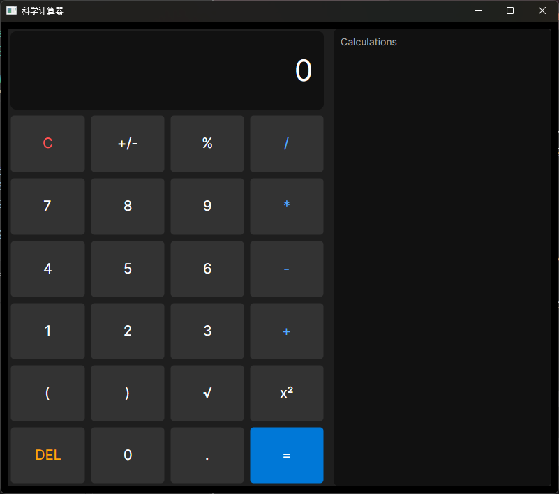

# Scientific Calculator (C# & Avalonia)

A modern, sleek desktop scientific calculator built with **C#** and **Avalonia UI**. 

This project was created as a hands-on learning journey to explore desktop application development, transitioning from web technologies (React/JS) to native C# programming.

## ✨ Features

- **Basic Arithmetic:** Addition, subtraction, multiplication, and division.
- **Scientific Operations:** Square root (`√`), square (`x²`), positive/negative toggle (`+/-`), and percentage (`%`).
- **Expression Evaluation:** Supports complex expressions with parentheses (e.g., `(10+20)*2/3`).
- **History Panel:** Automatically logs calculations and allows you to click on past records to reuse the result.
- **Modern UI:** Dark mode theme, rounded buttons, and hover effects.

## 🛠️ Tech Stack

- **Language:** C# / .NET 10
- **Framework:** Avalonia UI (Cross-platform)
- **IDE:** Visual Studio Code

## 📸 Screenshot



## 🚀 How to Run Locally

### Prerequisites
Make sure you have the [.NET 10 SDK](https://dotnet.microsoft.com/download) installed.

### Running the app
1. Clone the repository:
   ```bash
   git clone https://github.com/Chuan-dev086/CSharp_Calculator.git
   ```

2. Navigate to the project directory:
   ```bash
   cd CSharp_Calculator/MyDesktopApp
   ```

3. Run the application:
   ```bash
   dotnet run
   ```


## 📦 Building a standalone executable
To publish a single, self-contained .exe file that can run on any Windows machine (without requiring .NET to be installed): 

```
dotnet publish -c Release -r win-x64 --self-contained true -p:PublishSingleFile=true
```

The output executable will be located in bin/Release/net10.0/win-x64/publish/.

---
Built with ❤️ as a learning project.

